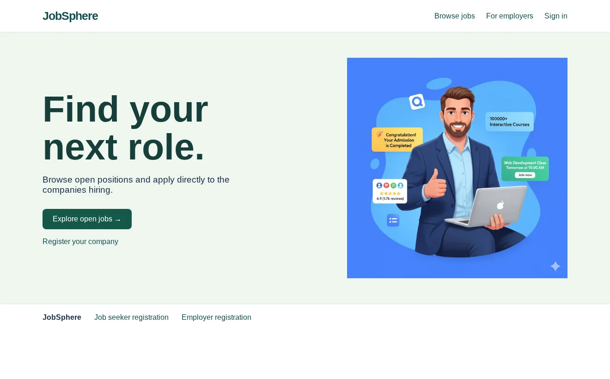
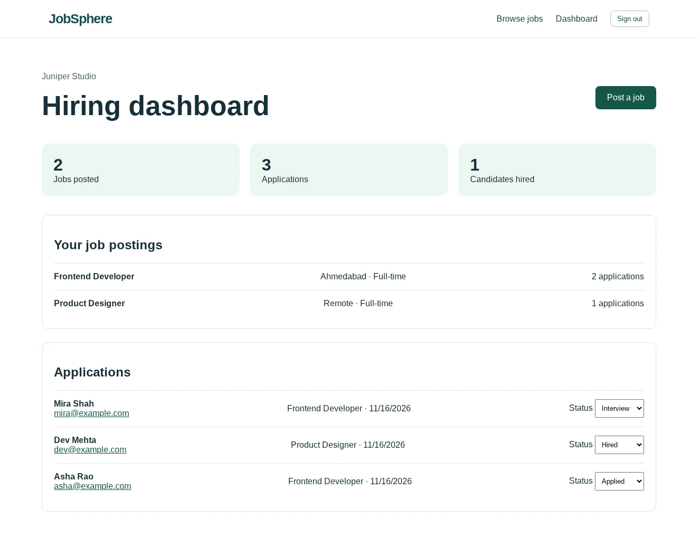

# JobSphere

**A full-stack job portal for candidates and hiring teams.** A candidate can browse open roles and submit an application. The employer can follow that same application from first review through interview, offer and hire.

**React 18 · JavaScript · Node.js · Express · MySQL**

[Hiring dashboard](#hiring-dashboard) · [Quick start](#quick-start) · [Try the hiring flow](#try-the-hiring-flow) · [Password reset email](#password-reset-email)



## Hiring dashboard

Each company sees its own job postings, applicant contact details and hiring totals. Updating an application's status to **Hired** immediately updates the hired count. The screenshot shows fictional applicants and openings.



| Job seekers | Employers |
| --- | --- |
| Browse roles within their posting dates and see salary, location and requirements. | Publish jobs with a salary range, employment type and application window. |
| Apply once per opening and see which roles they have already applied for. | Review candidate names, contact emails and the job each person applied for. |
| Recover an account with a six-digit code sent by email. | Move applications through Applied, Screened, Interview, Offer, Hired or Rejected. |

## Quick start

**Prerequisites:** Node.js 22 or 24 with npm, Git, and a running MySQL 8 or MariaDB instance. On Windows with XAMPP, start **MySQL** in the XAMPP Control Panel. Express serves the website, so Apache is optional.

**1. Clone the project.**

```sh
git clone https://github.com/MRPRANAVPATEL/job-portal.git
cd job-portal
```

**2. Set up the database connection.** Copy `backend/.env.example` to `backend/.env`. On Windows PowerShell:

```powershell
Copy-Item backend/.env.example backend/.env
```

On macOS or Linux:

```sh
cp backend/.env.example backend/.env
```

Open the new file and set `DB_USER` and `DB_PASSWORD` to your local database credentials. The defaults use `127.0.0.1:3306` and a database named `job_portal`. The database account needs permission to create the database and its tables. Leave `SESSION_SECRET` blank on first setup so the setup script generates it.

**3. Install dependencies and start the portal.** Run both commands from the repository root:

```sh
npm run setup
npm start
```

Open **[localhost:5001](http://localhost:5001)**. Setup installs the frontend and backend dependencies with `npm ci`, creates missing tables and builds React. The lockfiles are included in Git. The installed `node_modules` folders and private `.env` file stay on your computer.

**Next time:** Start your database, then run `npm start` from the project root.

## Try the hiring flow

1. Choose **For employers**, register a company, sign in and select **Post a job**. Set a posting window that includes today so candidates can see it.
2. Open a private browser window for a separate candidate session. Register a job seeker, sign in, browse jobs and apply to the new opening.
3. Return to the employer window and refresh the dashboard. Find the candidate, change their status to **Hired**, and check the updated count.

A new database starts empty. Posting the first job gives you an opening to use throughout this walkthrough.

## Password reset email

The job seeker sign-in page includes **Forgot password?**. To enable delivery, configure Nodemailer with your SMTP provider in `backend/.env`. For Gmail, use a sending mailbox and its app password:

```dotenv
SMTP_HOST=smtp.gmail.com
SMTP_PORT=587
EMAIL_USER=your-sending-mailbox@example.com
EMAIL_PASS=your-app-password
```

Restart the server after editing the file. Codes expire after ten minutes and allow five verification attempts. A verified code issues a single-use reset token. You can use the rest of the portal with the email fields blank.

## Development

| Task | Command from repository root |
| --- | --- |
| Start Express and serve the built React app | `npm start` |
| Run React with live reload in a second terminal | `npm start --prefix frontend` |
| Refresh the frontend served by Express | `npm run build` |
| Run the frontend test once | `npm test --prefix frontend -- --watchAll=false` |

For live reload, open [localhost:3000](http://localhost:3000) and keep Express running on port 5001. The React development server forwards API requests to Express.

The [React pages](frontend/src/pages) contain the candidate and employer interfaces. The [Express routes](backend/routes) handle authentication, job postings and application updates. The [database schema](backend/schema.sql) defines companies, users, jobs, applications and password recovery records.
